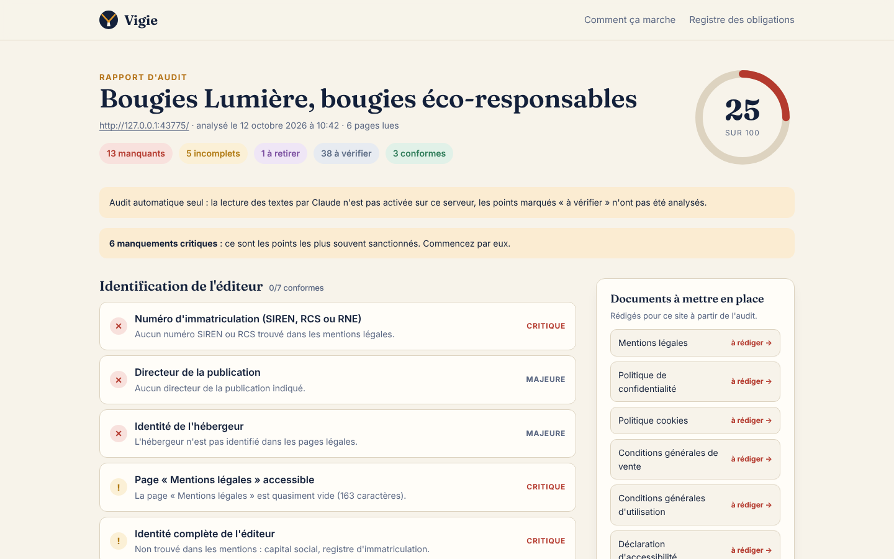

# Vigie

**Audit légal automatisé des sites web, en droit français et européen.**

On donne une URL. Vigie parcourt le site comme le ferait un contrôleur de la DGCCRF ou de la CNIL, relève ce qui manque ou est mal rédigé (mentions légales, CGV, CGU, politique de confidentialité, cookies, accessibilité…), puis rédige les textes adaptés au site lui-même.


## Ce que fait Vigie

1. **Parcours du site** dans un vrai navigateur (Chromium headless) : page d'accueil, pages légales, panier, compte, contact. Tout ce qui est chargé *avant* le moindre clic sur le bandeau cookies est enregistré (requêtes, cookies, services tiers).
2. **Profil du site** : e-commerce, abonnement, comptes, newsletter, chatbot IA, avis clients, vente d'alcool, B2B ou B2C… Le profil est déduit automatiquement et corrigeable par l'utilisateur ; le rapport se recalcule instantanément.
3. **Vérification** de 87 obligations, chacune rattachée à ses sources (Légifrance, EUR-Lex) :
   - 26 contrôles automatiques et déterministes (page présente en pied de page, SIREN valide et cohérent avec le répertoire Sirene, traceurs déposés sans consentement, bouton « Tout refuser », lien de rétractation, médiateur, lien ODR obsolète…) ;
   - les autres par lecture des textes par Claude, qui répond à une question précise par obligation, preuve à l'appui.
4. **Rapport** noté sur 100, trié par gravité, avec la preuve de chaque constat et ce que dit le texte.
5. **Rédaction** des documents manquants (mentions légales, confidentialité, cookies, CGV, CGU, déclaration d'accessibilité) : plan imposé, exigences et sources des seules règles applicables, faits observés sur le site, réponses de l'utilisateur. Les informations inconnues sont laissées en `[À COMPLÉTER : …]` plutôt qu'inventées, et un contrôle automatique vérifie le texte produit.



## Couverture juridique

Le catalogue (`src/lib/rules/catalogue.ts`) est la source unique : il alimente le moteur, la rédaction, la page publique `/registre` et [docs/registre-juridique.md](docs/registre-juridique.md). À jour au 12 octobre 2026, il couvre notamment :

- **Identification** : LCEN art. 1-1 et 1-2 (après la loi SREN), Code de commerce, Code de la consommation L111-1 et suivants ;
- **Données personnelles** : RGPD (art. 12 à 22, 28, 32, 44 et s.), loi Informatique et libertés (dont l'art. 85, directives post-mortem) ;
- **Cookies** : art. 82 de la loi Informatique et libertés, lignes directrices et recommandation CNIL (refus aussi simple que l'acceptation, 13 mois, mesure d'audience exemptée) ;
- **Vente à distance** : informations précontractuelles, bouton « commande avec obligation de paiement », droit de rétractation et **bouton de rétractation en ligne** (L221-21, ordonnance du 5 janvier 2026, depuis le 19 juin 2026), garanties légales, médiation, résiliation en trois clics (L215-1-1), réparabilité (directive 2024/1799, depuis le 31 juillet 2026) ;
- **Prix et promotions** : prix de référence sur 30 jours (Omnibus), avis clients (L111-7-2), classement et contenus sponsorisés ;
- **Plateformes** : DSA, règlement P2B, obligations des places de marché ;
- **Accessibilité** : European Accessibility Act depuis le 28 juin 2025 (hors micro-entreprises), RGAA et loi de 2005 ;
- **Environnement** : directive 2024/825 sur les allégations environnementales (depuis le 27 septembre 2026), loi AGEC ;
- **IA** : AI Act, art. 50 (transparence des chatbots et contenus générés, à partir du 2 août 2026) ;
- **Sectoriel** : alcool (loi Évin), immobilier (loi Hoguet), crédit, santé, tourisme, BTP, livre, jeux d'argent, formation, photos retouchées.

Les obligations abrogées sont signalées comme **à retirer** quand le site les affiche encore (exemple : le lien vers la plateforme européenne de règlement en ligne des litiges, fermée le 20 juillet 2025).

## Démarrer

Prérequis : Node.js 20 ou plus récent, et un Chromium (ou Chrome).

```bash
npm install
npx playwright install chromium   # ou renseigner CHROMIUM_PATH
cp .env.example .env.local        # puis ajouter ANTHROPIC_API_KEY
npm run dev                       # http://localhost:3000
```

Sans clé d'API, Vigie fonctionne en audit automatique seul : les points qui demandent une lecture des textes restent « à vérifier » et la rédaction est désactivée.

| Variable | Rôle |
|---|---|
| `ANTHROPIC_API_KEY` | Active l'analyse des textes et la rédaction par Claude. |
| `VIGIE_MODELE` | Modèle Claude utilisé (par défaut `claude-opus-5-5`). |
| `CHROMIUM_PATH` | Chemin du navigateur si Playwright ne le trouve pas. |
| `VIGIE_PROXY` | Proxy sortant du navigateur d'audit. |
| `VIGIE_DONNEES` | Dossier de stockage des audits (par défaut `data/audits`). |
| `VIGIE_AUTORISER_LOCAL` | `1` pour autoriser l'audit d'adresses locales (tests uniquement). |

### Commandes utiles

```bash
npm test                              # tests de bout en bout sur deux sites témoins + API Claude simulée
npm run typecheck
npm run audit -- https://exemple.fr   # audit en ligne de commande
npm run registre                      # régénère docs/registre-juridique.md
```

## Architecture

```
src/lib/crawler/     parcours du site (Playwright), détection des traceurs, des CMP et des signaux
src/lib/rules/       catalogue des obligations, contrôles automatiques, moteur de règles et score
src/lib/ia/          analyse des textes et rédaction par Claude (sortie structurée, flux)
src/lib/documents/   plans des documents à rédiger
src/lib/entreprise   vérification au répertoire Sirene (recherche-entreprises.api.gouv.fr)
src/app/             interface Next.js : accueil, rapport, rédaction, registre
tests/fixtures/      deux sites témoins : une boutique « risquée » et une boutique « soignée »
```

Le moteur est une fonction pure : `evaluer(profil, constatsAuto, constatsIA)`. Le score pondère les manquements par gravité (critique 10, majeure 5, mineure 2).

## Sécurité

- Le Markdown produit par Claude est assaini (aucun HTML brut, liens http, https et mailto uniquement).
- Les adresses locales et privées sont refusées à l'audit.
- Limites par IP : 6 audits par 10 minutes, 20 rédactions par heure.

## Limites connues

- **Un outil, pas un avocat.** Le catalogue a été établi avec soin et sourcé article par article, mais il doit être relu par un juriste avant toute commercialisation, puis tenu à jour (la date de dernière mise à jour est affichée partout).
- Le parcours ne clique pas dans les tunnels de commande : certaines obligations du processus d'achat restent « à vérifier ».
- Les pages légales de Vigie elle-même (`/mentions-legales`, `/confidentialite`, `/cgu`) contiennent des champs à compléter avant mise en ligne.
- Le nom « Vigie » doit être vérifié (INPI, nom de domaine) avant lancement.

Identité visuelle : [docs/identite-visuelle.md](docs/identite-visuelle.md).
